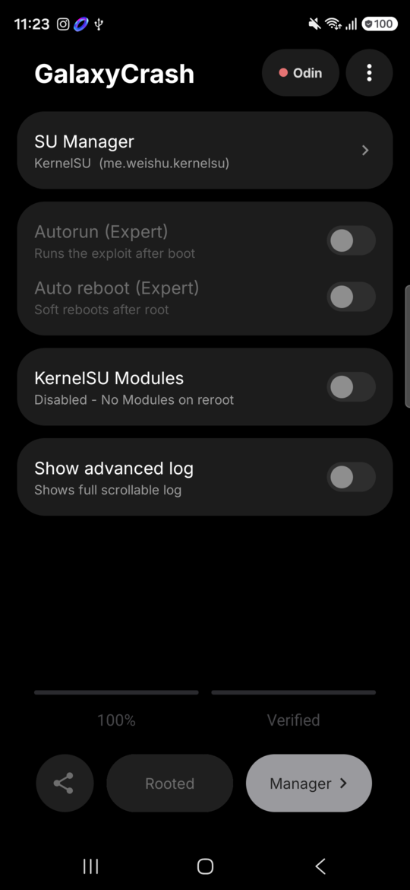

<p align="center">
  
</p>

<h1 align="center">GalaxyCrash</h1>

<p align="center"><strong>Root on a locked bootloader. No custom kernel, no Odin, no data wipe — and gone on reboot.</strong></p>

<p align="center">
  <a href="https://github.com/RemiPelloux/GalaxyCrash/releases/latest"></a>
  
  
  
  <a href="LICENSING.md"></a>
</p>

<p align="center">
  <b><a href="#-quick-start">Quick start</a></b> &nbsp;·&nbsp;
  <b><a href="#-what-this-fork-changes">What this fork changes</a></b> &nbsp;·&nbsp;
  <b><a href="#-how-it-works">How it works</a></b> &nbsp;·&nbsp;
  <b><a href="#-build-from-source">Build</a></b> &nbsp;·&nbsp;
  <b><a href="#-troubleshooting">Troubleshooting</a></b> &nbsp;·&nbsp;
  <b><a href="#-credits">Credits</a></b>
</p>

---

**GalaxyCrash** exploits [CVE-2026-43284](#the-vulnerability), a page-cache write in the Android
kernel's IPsec ESP path, to load a kernel module and start an SU daemon on a device whose bootloader
is still locked and whose kernel is still stock. Nothing is flashed. Nothing survives a reboot.

<p align="center">
  
</p>

<p align="center"><sub><b>Actual app on a Galaxy S26 Ultra (SM-S948B), Android 17, September 2026 patch.</b><br>
KernelSU in LKM mode, all eight markers through <code>dfm6</code>, SELinux back to Enforcing after the run.</sub></p>

> [!IMPORTANT]
> **Root is ephemeral by design.** The kernel module, `su`, and every module you load are gone the
> moment the device reboots. A reboot is also the recovery path: it always returns the phone to a
> clean, unrooted state. This is not a persistence tool.

## ✦ What this fork changes

This fork of [mitschud/DirtyFrag](https://github.com/mitschud/DirtyFrag) (renamed **GalaxyCrash**) is a **stability pass**,
built and verified on real hardware rather than read from source. Two defects were found, fixed, and
each proven with a failing test first.

<table>
<tr>
<td width="50%" valign="top">

### Fixed: modules toggle aborted the run

Setting **KernelSU Modules → Disabled** on a fresh KernelSU install — where `/data/adb/modules`
does not exist yet — made `bootstrap.c` return `-1` from `opendir()`. The run aborted **after** the
kernel hook was in place but **before** `ksud` started, leaving:

- no working root, and
- **SELinux left Permissive**.

That is the worst possible partial state, and it is the same failure as upstream issue #42. A
missing modules directory now means "nothing to disable" — success, which is what the user asked
for. Real errors (`EACCES`) still fail loudly.

</td>
<td width="50%" valign="top">

### Fixed: a failed run displayed as `Rooted`

Every "is this rooted" check trusted the existence of `/dev/df`, which is created early in the run.
Any later failure therefore left a marker that read as success on the next launch — the app showed
**`Rooted` / 100% / `Verified`** while KernelSU correctly said *not installed*. `BootReceiver`'s
"already hooked" guard was fooled the same way, silently suppressing autorun.

Root now requires `/dev/df` **and** `/dev/dfm6`, the marker `bootstrap` touches only once `ksud` has
started. A failed run also sets the failed-run interlock immediately.

</td>
</tr>
</table>

<details>
<summary><b>The full diff, and why <code>/proc/modules</code> was rejected as the check</b></summary>

<br>

| File | Change |
|---|---|
| `app/src/main/jni/bootstrap.c` | `disable_modules()`: `return errno == ENOENT ? 0 : -1;` |
| `app/src/main/java/df/root/RootState.java` | new — one definition of "rooted", used by both callers |
| `app/src/main/java/df/root/MainActivity.java` | 5 root checks routed through `RootState`, `failedRun` set on failure |
| `app/src/main/java/df/root/BootReceiver.java` | root check routed through `RootState` |

The first attempt at the root check read `/proc/modules` for the `kernelsu` entry. It worked from
`adb shell` and **always failed from inside the app**, because SELinux hides `/proc/modules` from
`untrusted_app`. A check that silently always fails is worse than no check, so it was replaced with
the `/dev/df` + `/dev/dfm6` pair — both created mode `0666`, both stat-able from the app's own
domain.

Both fixes were verified with a forced-failure negative test, not just a happy path.

</details>

## ✦ Quick start

**Requirements**

- A **64-bit ARM** device (arm64-v8a) on Android 12–17, bootloader locked or unlocked.
- An SU manager that ships `libksud.so`:
  - **Samsung:** [diabl0w's KernelSU](https://github.com/diabl0w/KernelSU/releases) — required.
  - **Other:** [KernelSU](https://github.com/tiann/KernelSU/releases/latest).
- `adb` if you want to drive it from a PC. Shizuku is **not** needed.

**Steps**

1. Install the SU manager first, then the GalaxyCrash APK from
   [Releases](https://github.com/RemiPelloux/GalaxyCrash/releases/latest).
2. Open GalaxyCrash, tap the **SU Manager** card and pick the manager you installed.
3. Tap the **Run** pill. It asks twice — that is the confirmation, not a bug.
4. Watch the log. Success ends at `bootstrap: starting SU daemon`; the pill then reads **`Rooted`**
   and your manager shows the module as live.

To undo: **reboot**. To undo permanently, uninstall the app.

## ✦ The chain

<p align="center">
  
</p>

<a name="how-it-works"></a>

### The vulnerability

The kernel decrypts AES-CBC ESP packets **directly into the page cache** of files opened for
`splice()`. By crafting

```
IV = AES_ECB_DEC(key, current_content) XOR desired_content
```

any 16-byte-aligned block of any mapped shared library can be overwritten — without write
permission, and without triggering copy-on-write. The file on disk is untouched; only the cached
page changes, so it lasts until the page is evicted or the device reboots.

### The steps

1. **ESP transform.** The app allocates a `UdpEncapsulationSocket`, an SPI, and an AES-CBC /
   HMAC-SHA256 transform through `IpSecManager`.
2. **`splicehelper` → `crash_dump64`.** The helper is spliced into `crash_dump64`, which runs in the
   `crash_dump` domain and can open `vendor_file`-labelled paths that `untrusted_app` cannot read.
3. **`dfroot.ko` → `vendor_file`.** The kernel module is written through that bridge, landing in a
   `vendor_file` path and bypassing module signature enforcement.
4. **`libc++.so` hook.** Shellcode is patched at `std::ostream::sentry::sentry()`. It checks uid and
   tid, creates `/dev/df` as a one-shot mutex so it cannot re-enter, then execs `insmod` in the
   `vendor_modprobe` domain.
5. **Module init.** Sets SELinux permissive, bypasses DEFEX via kprobes where present, then runs the
   bootstrap through `call_usermodehelper`.
6. **Bootstrap.** Reads the app's device-protected prefs, adopts the zygote environment, sets
   partitions read-only, optionally disables modules, and launches the SU daemon from your manager.

### Markers

`exp.c` watches these files to build the progress log. `dfm*` are progress, `dfmw*` are warnings
that do not stop the run, and `dfme*` are fatal.

| Path | Message | Kind |
|---|---|---|
| `/dev/df` | libc++: loading custom module | progress (one-shot mutex) |
| `/dev/dfm0` | kernel module: launching bootstrap | progress |
| `/dev/dfm1` | bootstrap: loading app preferences file | progress |
| `/dev/dfme0` | bootstrap: reading prefs failed | **fatal** |
| `/dev/dfm2` | bootstrap: cloning zygote env | progress |
| `/dev/dfmw0` | clone zygote env failed | warning |
| `/dev/dfm3` | bootstrap: setting partitions ro | progress |
| `/dev/dfmw1` | set partitions ro failed | warning |
| `/dev/dfm4` | bootstrap: disabling ksu modules | progress |
| `/dev/dfme1` | bootstrap: disable modules failed | **fatal** — the F-001 bug |
| `/dev/dfm5` | bootstrap: starting SU daemon | progress |
| `/dev/dfm6` | ksud start: SUCCESS | **success — this fork's root check** |
| `/dev/dfme2` | ksud start: nonzero exit | **fatal** |

## ✦ Features

- **Autorun** on boot, gated behind Expert mode, with a failed-run interlock that disables itself
  after one failure so a bad run cannot bootloop you.
- **Auto reboot** (soft reboot) after root. Works with every KernelSU derivative: `dfroot.ko` is
  unloaded after late-load and ksud's own `soft-reboot` runs.
- **KernelSU Modules** on/off — applied by the kernel module before `ksud` starts, so it works
  without root. This is the escape hatch when a module is what breaks your boot.
- **RO partition protection.**
- **Odin pill** — its dot tells you whether this firmware will let the device into download mode,
  and tapping it shows the three facts that decision comes from.
- **Update pill** — the headline becomes a lime `Update` pill when a newer release exists.
- **Advanced log**, one tap to save to Downloads.

## ✦ Build from source

```sh
export JAVA_HOME="$(mise where java@temurin-21)"   # JDK 21 is required
export ANDROID_HOME="$HOME/android-sdk"
./gradlew :app:assembleRelease --no-daemon
```

Output: `app/build/outputs/apk/release/galaxycrash.apk`.

You need `platforms;android-37.0`, `build-tools;37.0.0`, and NDK `27.1.12297006`. The eight kernel
modules are committed under `app/src/main/jni/ko/`, so **podman and the DDK image are not needed** —
upstream gitignores them and builds them per-KMI in CI; this fork ships them.

Release builds are signed with `app/keystore.jks`, which is gitignored. Without it the build still
succeeds and emits an **unsigned** APK, so a fresh clone can at least confirm it compiles. To produce
an installable APK, generate your own key:

```sh
keytool -genkeypair -v -keystore app/keystore.jks -alias dirtyfrag \
  -keyalg RSA -keysize 2048 -validity 10000 \
  -storepass dirtyfrag -keypass dirtyfrag
```

> [!NOTE]
> A locally built APK is signed with a different key than the published release, so Android refuses
> to upgrade in place. Run `adb uninstall com.galaxycrash.app` first.

The modules must be rebuilt whenever `lkm/dfroot.c` changes: run the **Build** workflow, download the
`df-lkm-<kmi>` artifacts, and drop them into `app/src/main/jni/ko/`.

## ✦ Troubleshooting

**"Patching failed / device not vulnerable"**
There is no fix. Your kernel is too new, your vendor backported the mitigation, or you hit
[accidental mitigation](https://github.com/V4bel/dirtyfrag/issues/23#issuecomment-4405314290)
(typically kernel 6.1).

**Log says success but there is no root**
Turn **Auto reboot** off first — an incomplete soft reboot leaves the module unloaded again. See
[upstream discussion 69](https://github.com/diabl0w/DFRoot/discussions/69).

**I installed a module and now root crashes**
Set **KernelSU Modules** to **Disabled** and re-root. The switch works without root, which is the
whole point.

**Bootloop after Module + Autorun**
Android usually offers Safe Mode; otherwise hold **Volume Down** during boot. From Safe Mode, turn
Autorun off and set Modules to Disabled. Worst case, `adb uninstall com.galaxycrash.app` works on user builds
without root.

**Progress bar stuck at 0%**
That is the log-marker mapping, not the exploit. The run window is 70 seconds — do not re-run a
"slow" run, the daemon may still be working.

**Removing root cleanly**
Reboot first. Then, with a root file manager, delete `/data/adb/KernelSU` and ksud residue — but
**not** the `adb` folder itself.

## ✦ Verified on

| | |
|---|---|
| Device | Samsung Galaxy S26 Ultra (SM-S948B) |
| Android | 17 — `CP2A.260605.016` / `S948BXXU4BZI6` |
| Kernel | `6.12.69-android16-6-pee899be-abogkiS948BXXU4BZI6-4k` |
| Patch level | 2026-09-05 |
| Bootloader | locked, verified boot green |
| Result | root, KernelSU LKM live, SELinux restored to Enforcing |

Tested on one build. The October patch — the one upstream issue #42 was filed against — was not
retested here.

## ✦ Credits

The exploit is not mine. This fork only hardens it.

- **Upstream project and exploit chain** — [diabl0w/DFRoot](https://github.com/diabl0w/DFRoot)
- **Direct parent of this fork, Samsung/RKP hardening, UI** — [mitschud/DirtyFrag](https://github.com/mitschud/DirtyFrag)
- **Original PoC and various code** — [lsposed/lspromise](https://github.com/lsposed/lspromise)
- **SELinux permissive kernel modules and various code** — [polygraphene/DFReroot](https://github.com/polygraphene/DFReroot)
- **Unprivileged XFRM socket method** — [combeng6th/DirtyInit](https://github.com/combeng6th/DirtyInit)
- **Stability fixes, licensing audit, documentation, artwork** — [Remi Pelloux](https://github.com/RemiPelloux)

## ✦ License

The [MIT license](LICENSE) covers **this fork's own changes only** — see
[LICENSING.md](LICENSING.md) for the exact file-by-file scope. It is deliberately not a claim over
the inherited exploit chain: neither upstream project publishes a license, so nobody downstream can
grant rights to that code. [THIRD_PARTY_NOTICES.md](THIRD_PARTY_NOTICES.md) lists what this
repository does not own, including the `MODULE_LICENSE("GPL")` kernel modules.

If you need a clean license for the whole tree, ask upstream to adopt one — that is the only way to
resolve it honestly.

## ✦ Disclaimer

This is a privilege-escalation exploit for Android. It can leave SELinux permissive if a run fails
partway, bootloop a device, and trip Knox. Use it only on hardware you own and are authorised to
test. No warranty of any kind.
